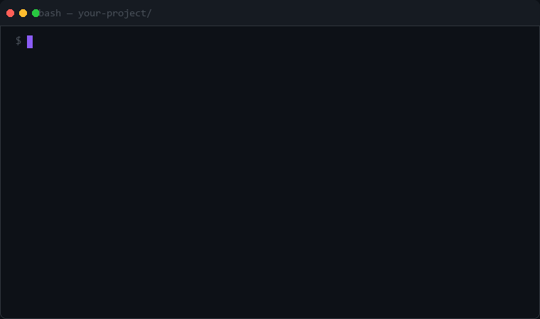

# Clankbrain

<p align="center"></p>

[](LICENSE) [](https://claude.ai/claude-code)



**Clankbrain is a ready-made setup for Claude Code.** It adds automatic hooks, organized memory files, a start-and-end-of-session routine and reusable workflows on top of what Claude Code already provides.

## What Claude Code already does

Claude Code has more built in than many people realize:

- **Instructions you write.** `CLAUDE.md` files and `.claude/rules/` (rules can apply only to certain file types).
- **Notes Claude writes itself.** *Auto memory* saves what Claude learns from your corrections and preferences, and loads it in every session.
- **Building blocks.** Hooks (small scripts that run at set moments), skills (saved instructions), subagents and plan mode.

If that is enough for you, you do not need Clankbrain.

## What Clankbrain adds

Claude Code gives you the parts. Its hooks page describes the mechanism only and ships no ready-made hooks. Clankbrain supplies the finished version:

| Claude Code gives you | Clankbrain adds |
|---|---|
| A hook system you configure yourself | Hooks already wired: they catch your corrections and turn them into lessons, check whether your notes still match the code, write a session journal and keep memory safe when a long chat is compacted |
| One auto-memory notes area, written by Claude | Separate files you can read, edit and track in git: lessons, decisions, rejected approaches and error fixes |
| Skills as a feature | **19 core workflows installed by default (36 in the repo)**, plus a score for each skill and an `/evolve` step that rewrites the ones that keep failing |
| `CLAUDE.md` and rules shared through git | Optional sharing of lessons, decisions and fixes between teammates through a private git repo you own, merged so nobody's entries are overwritten |
| Plan mode | A "show the plan, wait for my yes" rule and a `Start Session` / `End Session` routine |

Clankbrain was built from the author's own 335 sessions on one production project. Whether the extra structure is worth it for you depends on how you work. Try the Lite install first.

## Install

You need [Claude Code](https://claude.ai/claude-code) (or Codex), Python 3.7 or newer, and Node.js (only for the `npx` command).

```bash
npx clankbrain
```

The installer asks a few questions (about five) and sets everything up in about 30 seconds. No API keys, no database, no extra Python packages.

Prefer to read the code first? Clone this repo instead and run:

```bash
python tools/memory.py --init
```

> `npx clankbrain` downloads `setup.py` from this repository's `main` branch and runs it. Cloning lets you read it before it runs. See [SECURITY.md](SECURITY.md).

## Your first 10 minutes

Open Claude Code in your project and type these, one at a time:

| Type this | What happens |
|---|---|
| `kit-health` | Checks the install and shows green checks or warnings |
| `tour` | A 5-minute guided walkthrough |
| `Start Session` | Begins real work |

Stuck? The one-page [CHEATSHEET](docs/CHEATSHEET.md) lists everything, and [QUICKSTART](docs/QUICKSTART.md) walks through your first three sessions.

## How a session works

There are two commands. That is the whole routine.

**1. `Start Session`.** Claude reads its memory and tells you where you left off:

```
Ready. Last change: Session 42 - Dashboard pagination fix.
What are we working on?
```

**2. Do your work.** Before changing code, Claude shows a plan: the problem, the exact lines it will change, why it will work, and how to undo it. Nothing changes until you say yes. After the edit, it reads the lines back to confirm.

**3. `End Session`.** Claude looks back over the session, pulls out the lessons and saves them:

```
Extracted 3 lessons:
1. Debounce must wrap the filter handler, not the fetch call.
2. Page state must be reset when a filter changes.
3. ...
Saved to tasks/lessons.md. Session complete.
```

Next session, Claude loads those lessons before you type a word. See a full example in [demo/example-session.md](demo/example-session.md).

## Handy commands

| I want to... | Type |
|---|---|
| Start or end a session | `Start Session` / `End Session` |
| Pick up exactly where I left off | `/smart-resume` |
| Plan a change before touching code | `/plan` |
| Find existing code before writing new code | `/search-first` |
| Fix a bug step by step | `/fix-bug` |
| Search past lessons and decisions | `/recall your topic` |
| Save lessons from this session | `/learn` |
| See which skills are not working well | `/evolve-check` |
| Fix a skill using its failure history | `/evolve` |
| Create your own skill | `/skill-creator` |

Other skills (code review, UI design, security checks and more) live in `.claude/skills/` in this repo. Copy any folder into your own project's `.claude/skills/` to use it. The full list is in [docs/skills.md](docs/skills.md).

## What gets installed

**Memory files** are plain Markdown, so you can read and edit them yourself.

| File | What it holds |
|---|---|
| `tasks/lessons.md` | Things learned from mistakes and corrections |
| `tasks/decisions.md` | Choices you settled on, and why |
| `tasks/errors.md`, `tasks/error-lookup.md` | Problems you hit and how you fixed them |
| `tasks/regret.md` | Approaches you rejected, so Claude does not suggest them again |
| `STATUS.md` | Where the project stands right now |
| `.claude/memory/` | Longer notes: code maps, project status, preferences |

**Hooks** are small scripts that Claude Code runs automatically at certain moments. You never run them yourself.

| When | What it does |
|---|---|
| A session starts | Loads memory and greets you with the last change |
| You send a message | Notices when you correct Claude and queues it as a lesson |
| After Claude edits a file | Logs the edit and checks whether your notes about the code are now out of date |
| Before and after Claude compacts a long conversation | Keeps your memory from being lost |
| Claude finishes replying | Saves a session journal, updates today's date and reminds you to run `End Session` |

Details: [docs/hooks.md](docs/hooks.md).

**Skills** make the workflows repeatable. Each one has steps and, over time, a score. `/evolve-check` shows which skills keep failing, and `/evolve` rewrites their steps using that history.

## Lite or Full?

The installer asks which size you want.

| | Lite | Full |
|---|---|---|
| Memory files | Fewer | The complete set |
| Automatic checks (hooks) | None | Yes |
| Session journal | When you run `End Session` | Saved automatically |
| Best for | Trying it out, small projects | Long-running projects |

Not sure? Start with Lite. Type `Upgrade to Full` any time. More: [docs/architecture.md](docs/architecture.md).

## Works with other tools

- **Codex:** the installer also writes `AGENTS.md`, so Codex reads the same memory.
- **Cursor and Windsurf:** run the installer with `--ide cursor` or `--ide windsurf` to create their rule files. Hooks and skills work only in Claude Code. Details: [docs/other-ides.md](docs/other-ides.md).
- **GitHub Copilot:** not supported.

## Extras

- **Team sync.** Share lessons with teammates through your own private GitHub repo. Personal notes stay on your computer. See [docs/sync.md](docs/sync.md) and [docs/clankbrain-for-teams.md](docs/clankbrain-for-teams.md).
- **Dashboard.** A small status page in your browser. Run `node _tools/dashboard/server.js`, then open http://localhost:3030.
- **Semantic search.** `/recall` finds notes by meaning, not just exact words. This needs the optional `sentence-transformers` package (about 90 MB, runs offline). Without it, `/recall` falls back to a keyword search.
- **Global lessons.** `~/.claude/global-lessons.md` holds rules that apply to every project.

## Troubleshooting

- **Blank conversation after `Start Session`.** Open a new conversation and type `Update Kit`. It repairs the hook files. Then type `Start Session` again.
- **Hooks do nothing.** Update Claude Code. Very old versions (for example 2.1.29) silently ignore all hooks if the settings file mentions a hook name they do not know.
- **Something else.** Check the [FAQ](docs/faq.md) or ask in [Discussions](https://github.com/YehudaFrankel/clankbrain/discussions).

## Privacy

Your memory files and code stay on your computer. Team sync is optional and goes only to a repository you own. The kit does send one anonymous usage ping when setup finishes and when a session starts (a random ID, the install mode, platform and Python version, with no project data). To turn it off, set the environment variable `CLANKBRAIN_NO_TELEMETRY=1`.

## Learn more

- [CHEATSHEET](docs/CHEATSHEET.md) - everything on one page
- [QUICKSTART](docs/QUICKSTART.md) and [FIRST5](docs/FIRST5.md) - your first sessions
- [Why Clankbrain](docs/why.md) and the [FAQ](docs/faq.md)
- [All commands](docs/commands.md), [skills](docs/skills.md), [hooks](docs/hooks.md), [rules](docs/rules.md), [agents](docs/agents.md)
- [Architecture and file layout](docs/architecture.md) and [extending the kit](docs/extending.md)
- [Changelog](CHANGELOG.md) and [example memory files](examples/)

## For contributors: do not move these files

These files in the repo root serve the project website through GitHub Pages. Moving them breaks the site:

- `index.html` (the home page)
- `googleb8fe14024404ae1c.html` (Google Search Console verification)
- `sitemap.xml`, `robots.txt`
- `logo.jpeg`, `memory-starter-kit.png`, `demo.gif` (images used by the site and this README)

To separate the site from the kit, first move Pages to a `gh-pages` branch or a separate repo.

---

Built by [Yehuda Frankel](https://github.com/YehudaFrankel) over 335 sessions of daily use on a production project. Using it on a real project? [Tell us what you are building](https://github.com/YehudaFrankel/clankbrain/discussions).
